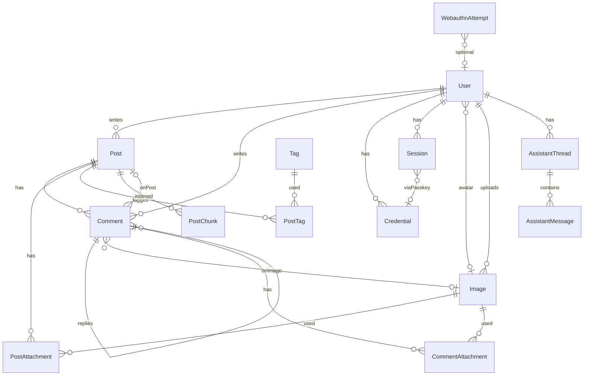

# Database map

SQLite via Drizzle ORM. Schema lives under [`server/database/schema/`](../../server/database/schema/). Validators (Zod) sit beside the schema as `*.validators.ts`. Migrations are generated - do not edit `server/database/migrations/` by hand.

## Entity-relationship overview

## Tables

| SQL table | Schema file | Role |
|-----------|-------------|------|
| `User` | [`auth/users.ts`](../../server/database/schema/auth/users.ts) | Accounts; password and/or passkey; optional avatar image |
| `Credentials` | [`auth/credentials.ts`](../../server/database/schema/auth/credentials.ts) | WebAuthn passkeys per user |
| `Session` | [`auth/sessions.ts`](../../server/database/schema/auth/sessions.ts) | Login sessions (JWT ties to session id) |
| `WebauthnAttempt` | [`auth/webauthnAttempts.ts`](../../server/database/schema/auth/webauthnAttempts.ts) | Short-lived WebAuthn challenge state |
| `Post` | [`posts.ts`](../../server/database/schema/posts.ts) | Blog posts (`mode` legacy\|formatted; optional `content_html`, `description`, `excerpt`) |
| `Tag` / `PostTag` | [`tags.ts`](../../server/database/schema/tags.ts) | Tags and post↔tag join |
| `Image` | [`images.ts`](../../server/database/schema/images.ts) | Blob metadata (`path`, description, optional `uploaded_by`) |
| `PostAttachment` | [`postsAttachment.ts`](../../server/database/schema/postsAttachment.ts) | Images on a post; optional cover |
| `Comment` | [`comments.ts`](../../server/database/schema/comments.ts) | Comments on a post **or** on an image (XOR check) |
| `CommentAttachment` | [`commentsAttachment.ts`](../../server/database/schema/commentsAttachment.ts) | Images attached **to** a comment |
| `AssistantThread` | [`assistant.ts`](../../server/database/schema/assistant.ts) | Logged-in assistant chat threads |
| `AssistantMessage` | [`assistant.ts`](../../server/database/schema/assistant.ts) | UIMessage parts JSON per thread |
| `PostChunk` | [`assistant.ts`](../../server/database/schema/assistant.ts) | RAG text chunks; vectors in `post_chunk_vec` (sqlite-vec) |

Drizzle relation helpers: [`relations.ts`](../../server/database/schema/relations.ts). Barrel: [`index.ts`](../../server/database/schema/index.ts).

## Foreign keys and constraints

### User

- `avatar` → `Image.id` (`onDelete: set null`) - deleting the image clears the avatar, not the user
- Checks: `auth_method` ∈ `password|passkey|both`; password required unless passkey-only

### Credentials

- `id` is primary key (`text`)
- `userId` → `User.id` (`cascade`)

### Session

- `userId` → `User.id` (`cascade`)
- `credentialId` → `Credentials.id` (`onDelete: set null`); password sessions leave it null
- Soft flags: `revoked`, `invalidated` + `invalidReason`
- Passkey delete: soft-invalidate sessions **before** deleting the credential (so FK set-null does not lose the match)

### Post

- `userId` → `User.id` (`cascade`)
- `mode` - `legacy|formatted` (default `legacy`; immutable after create)
- `content` - plain text (legacy) or TipTap JSON string (formatted)
- `content_html` - sanitized HTML for formatted posts (null for legacy)
- `description` - optional plain list/search blurb
- `excerpt` - persisted plain preview (from description or stripped body) for list/`q`

### Tag / PostTag

- `PostTag.postId` → `Post.id`, `PostTag.tagId` → `Tag.id` (composite PK)
- `Tag.name` / `Tag.slug` unique

### Image

- Standalone metadata; referenced by avatar, post attachments, comment attachments, and optionally as a comment *target*
- `uploaded_by` - logical user id of the uploader, cannot be added on avatar upload as the image data has been added before user. Set on upload; post/comment create/update only attach images the user uploaded or that are already on that post/comment (`assertUserMayAttachPostImages`)

### Comment

- `userId` → `User.id` (`cascade`)
- `postId` → `Post.id` (`cascade`, nullable)
- `imageId` → `Image.id` (`cascade`, nullable) - comment **on** an image
- `parentId` → `Comment.id` (`cascade`) - threaded replies
- Check `comment_entity_check`: exactly one of `post_id` / `image_id` is set

### PostAttachment

- (`postId`, `imageId`) PK; both FKs cascade
- Partial unique index: at most one `post_cover = 1` per post

### CommentAttachment

- (`commentId`, `imageId`) PK; both FKs cascade
- Images **on** a comment (different from `Comment.imageId`)

### WebauthnAttempt

- `userId` optional integer (no FK declared)
- Types: `register` | `authenticate` | `add_credential`

### AssistantThread / AssistantMessage

- `AssistantThread.userId` → `User.id` (`cascade`)
- `AssistantMessage.threadId` → `AssistantThread.id` (`cascade`)
- `parts_json` stores AI SDK UIMessage parts

### PostChunk

- `postId` → `Post.id` (`cascade`)
- Companion virtual table `post_chunk_vec(chunk_id, embedding float[DIM])` created at DB boot

## Drizzle relations

| Relation export | Edges |
|-----------------|-------|
| `usersRelations` | posts, comments, credentials, sessions, avatar→images |
| `credentialsRelations` | user, sessions |
| `sessionsRelations` | user, credentials |
| `postsRelations` | user, comments, attachments, postTags |
| `imagesRelations` | comments (as target), commentAttachments, postAttachments, users (avatars) |
| `commentsRelations` | user, posts, images, parent/replies, attachments |
| `commentAttachmentsRelations` | comment, image |
| `postAttachmentsRelations` | post, image |
| `postTagsRelations` | post, tag |
| `tagsRelations` | postTags |

## Validators

| File | Used by |
|------|---------|
| [`users.validators.ts`](../../server/database/users.validators.ts) | register, login (`userSchema`), profile (`profilePatchSchema`), webauthn register |
| [`posts.validators.ts`](../../server/database/posts.validators.ts) | post create/update |
| [`comments.validators.ts`](../../server/database/comments.validators.ts) | comment create/update |

API handlers wrap Zod via [`useSafeReadValidateBody`](../../server/composable/useSafeReadValidateBody.ts) so 422 payloads stay field-oriented.

## Comment / image mental model

Two different "image" roles on comments:

1. **Target** - `Comment.imageId`: the comment is *about* that image (schema + XOR with `postId`). Public comment APIs currently only accept `item === 'post'`.
2. **Attachment** - `CommentAttachment`: images uploaded *with* a comment on a post.
