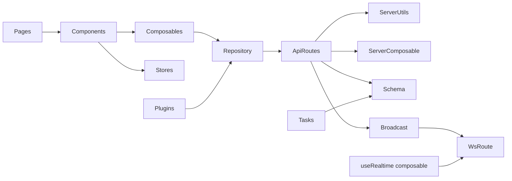
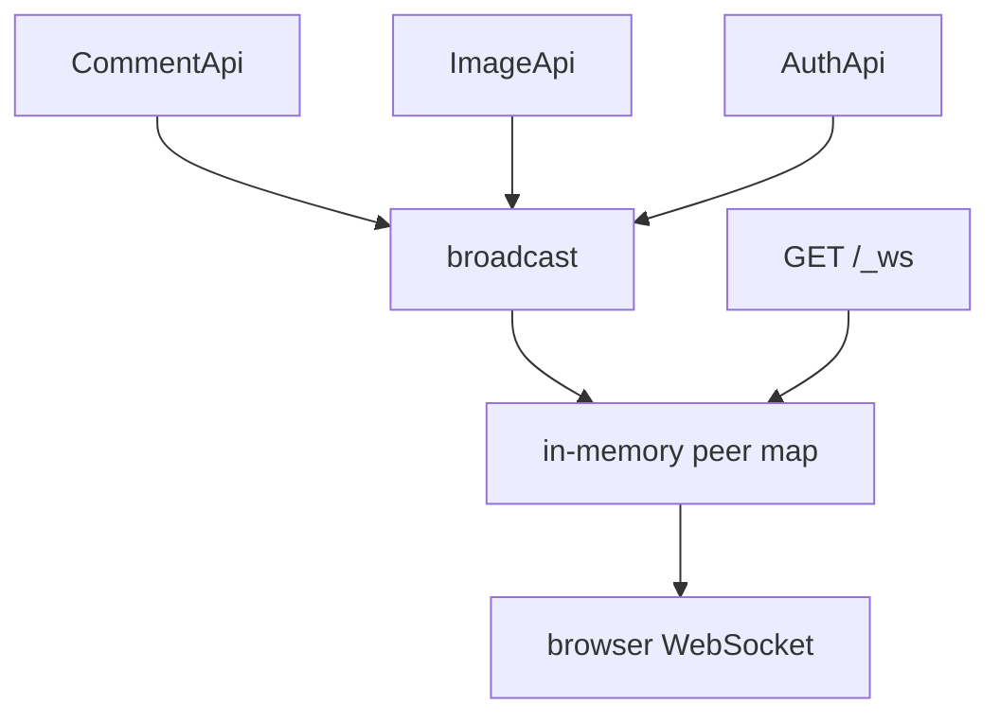
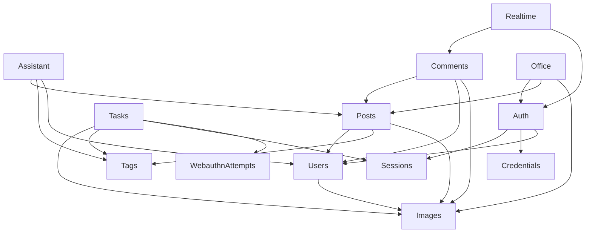

# Relations and cross-usage map

How layers and feature modules call each other. There is no `services/` folder; "service" work lives in repositories (client), `server/utils` + `server/composable` (server), and Nitro tasks.

## Layer flow

Client consumers of `useRealtime`: comments UI, office credentials, office sessions.

## Client → API (repository)

Wired in [`app/plugins/fetch.ts`](../../app/plugins/fetch.ts) as `$api` + `$appFetch`.

| Repository | Methods → HTTP | Consumed by |
|------------|----------------|-------------|
| [`user.ts`](../../app/repository/user.ts) | register/login → `/auth/*`; WebAuthn → `/api/auth/webauthn/*`; sessions → `/api/auth/sessions/*`; profile → `/api/auth/profile`; check → `/auth/check` | login/register pages, office credentials/sessions, `useProfileEditForm`, `ensureAuthChecked`, user store logout |
| [`posts.ts`](../../app/repository/posts.ts) | `GET/POST posts/`, `GET posts/my`, `GET/PUT/DELETE posts/:id` | post list/detail/form, office posts, `useUserPostFetch` |
| [`comments.ts`](../../app/repository/comments.ts) | `GET/POST comments/post/:id`, `PUT/DELETE comments/:id` | comments UI, comment-form |
| [`images.ts`](../../app/repository/images.ts) | `POST /images/posts|comments/:id`, `POST /api/images/avatar/` | post form, comment-form, avatar upload |
| [`tags.ts`](../../app/repository/tags.ts) | `GET tags/` | post form + filters; prerender popular tags via raw SQL in `nuxt.config.ts` |
| [`assistant.ts`](../../app/repository/assistant.ts) | `GET/POST/DELETE assistant/threads*` | assistant panel history; chat via `POST assistant/chat` |

Stores updated from repositories: `posts` store (`addPosts` from list/my), `user` store (auth flows). Stores must not call APIs directly (logout is the exception: store → `$api.auth.revokeSession`).

## Server API → DB / utils

### Auth

| Route | Auth | Tables | Utils / other |
|-------|------|--------|---------------|
| `POST /api/auth/register` | - | users, images, sessions | `useSafeReadValidateBody`, `createSession`, `signToken` |
| `POST /api/auth/login` | - | users, images, sessions | bcrypt, `createSession`, `signToken`, `broadcast` `user:{id}` |
| `GET /api/auth/check` | soft | users, sessions, images | `loadSession` / auth utils |
| `PATCH /api/auth/profile` | `requireAuth` | users, images, credentials, sessions | bcrypt, validators |
| `GET/DELETE /api/auth/sessions/*` | `requireAuth` | sessions | `broadcast` on revoke |
| WebAuthn register/login/credentials | mix | users, credentials, webauthnAttempts, images, sessions | SimpleWebAuthn, `useLookUpIp`, `createSession`, `signToken`, `broadcast`, `uaparser` (credentials list) |

Shared auth helpers: [`server/utils/auth.ts`](../../server/utils/auth.ts) (`requireAuth`, `signToken`, session touch + `x-auth-token`), [`server/utils/session.ts`](../../server/utils/session.ts) (`createSession` + geo via `useLookUpIp`), [`server/config/auth.ts`](../../server/config/auth.ts), [`shared/auth.ts`](../../shared/auth.ts) (lifetimes).

### Posts

| Route | Tables | Utils |
|-------|--------|-------|
| `GET /api/posts/` | posts, users, tags, postTags | filters (author, tags, dates, q) |
| `GET /api/posts/my` | posts | auth |
| `GET /api/posts/:id` | posts, users | - |
| `POST /api/posts/` | posts, tags, postTags, postAttachments | `requireAuth`, validators, `slugify`, `sanitizePostHtml`, `buildPostExcerpt` |
| `PUT /api/posts/:id` | same | owner check, mode immutable, attachment replace when `images` sent, `sanitizePostHtml`, `buildPostExcerpt` |
| `DELETE /api/posts/:id` | posts | `requireAuth` + owner check (403 if foreign); async RAG vector cleanup |

Post create/update also fire-and-forget `indexPostById` for RAG.

### Assistant

| Route | Auth | Tables / utils |
|-------|------|----------------|
| `POST /api/assistant/chat` | soft | guest rate limit; AI SDK stream; tools; optional thread persist |
| `GET/POST /api/assistant/threads` | `requireAuth` | AssistantThread |
| `GET/DELETE /api/assistant/threads/:id` | `requireAuth` | AssistantThread, AssistantMessage |

### Comments

| Route | Tables | Utils |
|-------|--------|-------|
| `GET /api/comments/post/:id` | comments, users, images, commentAttachments | item must be `post` |
| `POST /api/comments/post/:id` | comments, commentAttachments | `requireAuth`, validators, `broadcast` `post:{id}` |
| `PUT/DELETE /api/comments/:id` | comments, commentAttachments, images (+ blob on delete) | `requireAuth`, `broadcast` |

### Images

| Route | Tables / storage | Utils |
|-------|------------------|-------|
| `POST /api/images/posts|comments/:id` | images (`uploaded_by`), postAttachments / commentAttachments, posts, comments; hub blob | `requireAuth`, `broadcast` on comment description updates |
| `GET /api/images/posts|comments/:id` | attachment joins | - |
| `POST /api/images/avatar` | images (`uploaded_by` when session exists); hub blob | No auth required (register uploads before account); profile PATCH links avatar id |
| `POST/PUT /api/posts` | posts, postAttachments | `assertUserMayAttachPostImages` before linking `images[].id` |
| `POST /api/comments/post/:id`, `PUT /api/comments/:id` | comments, commentAttachments | `assertUserMayAttachPostImages` before linking `images[].id` (re-attach allowed via `commentId`) |

Serving: [`server/routes/images/[...pathname].get.ts`](../../server/routes/images/[...pathname].get.ts) (blob), [`server/routes/_img/[...pathname].get.ts`](../../server/routes/_img/[...pathname].get.ts) (sharp resize), provider [`nuxtHubBlobIpx`](../../server/providers/nuxtHubBlobIpx.ts).

### Tags

| Route | Tables |
|-------|--------|
| `GET /api/tags/` | tags |
| `GET /api/tags/popular` | tags, postTags |

## Broadcast / realtime

Channels used in production code:

- `post:{id}` - comment created/updated/deleted; comment image description updates
- `user:{id}` - sessions added/revoked; credentials added/removed

Client consumer: [`useRealtime`](../../app/composables/useRealTime.ts) in `comments.vue`, `credentials.vue`, `sessions.vue`.

**Deploy note:** broadcast is process-local - single Nitro instance only (multi-instance pub/sub deferred; see [review-flags.md](review-flags.md)).

## Tasks (Nitro)

| Task | Cron (`nuxt.config` nitro.scheduledTasks) | Touches |
|------|------------------------------------------|---------|
| `cleanup:orphan-images` | every 10 min | images vs attachments/avatars + blob |
| `cleanup:webauthn-attempts` | every 10 min | webauthnAttempts |
| `cleanup:sessions` | every 10 min | sessions |
| `cleanup:tags` | daily 04:00 | unused tags |
| `db:migrate` | on boot via [`server/plugins/migrate.ts`](../../server/plugins/migrate.ts) | migrations |
| _(boot)_ runtime env mirror | [`mirror-runtime-env.mjs`](../../server/utils/mirror-runtime-env.mjs) via [`docker-entrypoint.sh`](../../scripts/docker-entrypoint.sh) | copies every env name to `NUXT_*` before Nitro import |
| `db:backup` | **not scheduled** - manual | SQLite file snapshot |
| `db:seed` | **not scheduled** - manual  | seed data |
| `assistant:reindex-posts` | **not scheduled** - manual | PostChunk + sqlite-vec backfill |

## Cross-module dependency graph (features)

## App middleware / plugins

| Piece | Depends on |
|-------|------------|
| [`auth.global.ts`](../../app/middleware/auth.global.ts) | auth cookie, user store, route meta |
| [`post-owner.ts`](../../app/middleware/post-owner.ts) | `ensureAuthChecked`, `useUserPostFetch` |
| [`fetch` plugin](../../app/plugins/fetch.ts) | Pinia, repositories, auth cookie headers |
| [`init-auth` plugin](../../app/plugins/init-auth.ts) | fetch plugin, `ensureAuthChecked` |
| [`pwa-dev-cleanup.client.ts`](../../app/plugins/pwa-dev-cleanup.client.ts) | unregister SW in dev |

## Shared package

| File | Used by |
|------|---------|
| [`shared/auth.ts`](../../shared/auth.ts) | server auth/session, client auth-cookie |
| [`shared/types/utils.d.ts`](../../shared/types/utils.d.ts) | `Unwrap` (forms), `SingleKeyOfType` (`useForm`) |

## Notable cross-cuts

- **IP geo**: `useLookUpIp` from session create and WebAuthn credential/register verify (external `ip-api.com`).
- **Prerender**: `nuxt.config.ts` opens SQLite with `better-sqlite3` for popular tags + authors routes - bypasses Drizzle/API.
